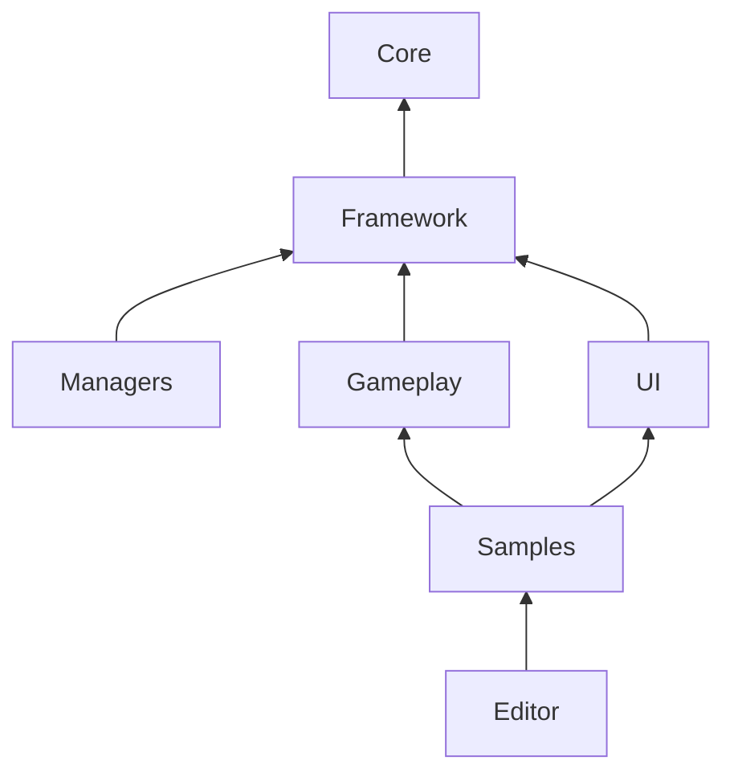

# 接入与扩展

## 程序集依赖



箭头表示编译期引用。Framework 和 Core 不引用 Managers、Gameplay 或 UI。Managers 内部使用 Framework 的契约；UI 通过事件接收背包快照、玩家状态与对白。Samples 负责演示装配，可整目录删除，同时移除依赖它的 Editor 演示生成器。正式游戏可保留自己需要的 Editor 工具。

Core 是工具层：MonoSingleton、Unity 数学、协程与 JSON 辅助仍依赖 UnityEngine；PureSingleton / ObjectPool 和纯 FSM 的逻辑不依赖具体游戏业务。

## 事件接线示例

```csharp
private readonly SubscriptionBag subscriptions = new SubscriptionBag();
private void OnEnable()
{
    subscriptions.Add(EventBus.Subscribe<LowSanChanged>(e => ApplyFearEffect(e.Active)));
}
private void OnDisable() => subscriptions.Dispose();

// 环境音、跳吓或剧情向其他模块发请求：
EventBus.Publish(new PlaySoundRequested(clip, transform.position));
EventBus.Publish(new DialogueRequested(dialogue));
EventBus.Publish(new SpawnEntityRequested(definition, point.position, point.rotation, sceneContent));
```

需要“立即返回值”的同模块计算直接调用方法。框架内的拾取和场景请求使用同步回调或完成回调返回结果。不要把跨模块事务拆成互相无法判断结果的广播；一个请求应有唯一处理者。单机起步版面向单玩家，不包含联网或多本地玩家路由。

## 角色与 AI

创建 **Guisha → Entity Definition** 资产，填写 EntityId、EntityType、最大生命、移动速度、伤害与 prefabAddress。创建 **Guisha → Entity Catalog** 收集配置，将它绑定到 FrameworkSettings.entityCatalog 后，可用 `SpawnEntityByIdRequested(EntityId.RedGhost, position, rotation, parent)` 按枚举生成；也可直接传 EntityDefinition，或在组合根创建带 Catalog 的 EntityFactory。Catalog 中 ID 必须唯一。

玩家预制体挂 CharacterController、PlayerEntity、PlayerStatus、PlayerController、PlayerInteractor、Inventory、SanSystem。模型放子节点，不让视觉模型额外的非触发碰撞器阻塞 CharacterController。相机挂 Camera、AudioListener、PlayerCamera，绑定 target；工程保持一个有效 AudioListener。

人类挂 HumanNPC，配置对白与可射线命中的 Collider。鬼怪挂 GhostEntity、AIPerception、GhostBrain、NavMeshAgent，并在场景准备可行走的 NavMesh。多个鬼怪使用不同 Definition 及感知参数；GhostBrain 的 Patrol / Investigate / Chase / Attack / Return 是现成的五态起点。正式项目可把状态拆成各自文件或增设角色专属状态，避免在一个巨型 switch 中堆行为。

视觉锥、遮挡和听觉通过 perception 参数控制；targetMask 应只包含玩家层，obstructionMask 选择墙体、门等遮挡层。演示默认为全层并过滤自身/目标层级，正式场景请配置专用层来减少查询成本。感知与 San 按固定间隔查询，当前实现仍有物理查询数组分配。AI 攻击使用距离与感知检查；正式动画可以把伤害改到 Animation Event 的命中帧。门的动态寻路阻挡请配置 NavMeshObstacle 或项目的动态导航方案。

## Addressables 生命周期

ResourceManager 实现 `IResourceProvider`。同类型、同地址的并发 `LoadAsync<T>` 合并为一个句柄；每个调用者获得独立 `AssetLease<T>`。缓存仅在有调用者持有 lease 时保留，最后一个 lease Dispose 后释放句柄，因此没有额外的闲置永久缓存。

```csharp
using (var lease = await provider.LoadAsync<AudioClip>(address, cancellationToken))
{
    // 在 lease 生命周期内使用 lease.Asset。
    // 如果 AudioSource 仍在播放，要保留 lease 到播放结束之后。
}
```

`InstantiateAsync` 使用 Addressables 的实例化 API；返回 ResourceInstance，可显式 Dispose。实例上的 InstanceLifetime 会在销毁时释放自身句柄；不要自行再调用 Addressables.ReleaseInstance 导致重复释放。EntityFactory 校验 BaseEntity / EntityType，配置实体并广播 EntitySpawned。默认生成通过事件转发到 ResourceManager 内部工厂；需要返回实体时可在组合根构造 `new EntityFactory(provider)` 并 await。

SpawnEntityRequested 的 parent 应传入所属场景的内容节点，确保实例随场景停用/卸载。原父节点在加载期间被销毁时，工厂会释放刚加载的实例。CancellationToken 是逻辑取消：Addressables 本身的加载不中断；框架等待底层完成后释放取消的结果，随后抛出 OperationCanceledException。此机制避免提前释放仍在执行的共享加载。不要把取消当成立即中止下载。

## 附加场景

SceneFlowManager 串行处理切换，加载新场景为 Additive，激活成功后卸载旧副本，保留诡舍主场景。场景路径使用 `Assets/.../Name.unity`，必须加入 Build Settings。此处场景通过内置 SceneManager 加载，资源与角色通过 Addressables；若未来场景也改成 Addressables，需整体替换为场景句柄配对加载/卸载。

每个场景根对象挂 ActiveSceneContent，把玩家、相机、UI、NPC、碰撞、灯光等放在独立 content 子节点下。该组件先停用旧场景内容，再激活新场景内容，保持唯一玩家、面板与监听器。组件本体不要放在自己被关闭的 content 节点中。没有设置 content 时组件不做切换，适用于纯常驻环境。

首次请求会把当时的活动场景认作常驻主场景。正式工程建议在 FrameworkSettings.persistentScenePath 显式指定主场景；独立启动副本调试时也应知道当前场景是否被保留。切换遇到错误会尝试回滚活动场景和刚加载的场景，记录异常并回调失败。

## 存档

存档位置：`Application.persistentDataPath/Saves/slot1.json`。保存内容：版本、活动场景、当前副本、检查点、玩家位置/旋转、生命、San、体力、物品 ID、世界标记。已有检查点时保存的出生位置取检查点位置；没有检查点时取当前位置。Checkpoint.respawnPoint 可指定安全落点。

机制、纸条、拾取物、剧情触发器使用**全游戏唯一且稳定的 ID**，推荐 `场景.对象.用途`。WorldState 保存标记；拾取物隐藏渲染与碰撞而不销毁组件，便于同场景读档恢复。门会存解锁标记，读档时关闭门扇；门当前的开合角度不保存。怪物位置/生命、播放到一半的对白/过场、未配置 persistentId 的触发器和随机数状态不保存；需要它们时扩展 SaveData 与 SaveCapture / SaveLoaded。

读档恢复玩家状态、背包和世界标记，并结束对话/过场、关闭模态面板释放输入锁。场景不同则先切换，完成后恢复。JSON 使用 JsonUtility 字段序列化，不支持 Dictionary、多态接口和顶层数组；配置表应包装为可序列化容器。版本号目前为 1，后续调整结构时添加迁移。

写入流程使用临时文件和上一版 .bak；不是事务数据库，也不保证平台断电原子性。主文件不可解析时尝试 .bak。WebGL/移动平台的持久化和文件日志需在目标平台验证；当前以桌面单机为目标。

## UI、音频和过场

UIPanelBase 通过 CanvasGroup 显隐，GameObject 保持激活以持续接收事件，panelId 在当前场景唯一。UIManager 维护面板顺序，模态面板锁输入并阻止下层交互。扩展 Open/Close 可加入动画。HUD 的 Slider 值采用 0–1；演示使用数值文字，正式 HUD 可给 sanBar/staminaBar 绑定 Slider。

音频触发用 PlaySoundRequested / BgmRequested 或 AudioFacade。使用 Addressables 加载的音频，调用者应持有 lease 直到播放结束。遮挡默认射线检测并加低通，正式场景设置 audioOcclusionMask，避免装饰或角色碰撞器造成非预期遮挡。

对话资产 DialogueAsset 用 node 数组索引连接，next = -1 表示结束；有 choices 时走选择分支。CutscenePlayer 需要 PlayableDirector 和 Timeline；镜头动画放 Timeline 轨道，可选 cutsceneCamera 使用更高的 Camera Depth，避免增加第二个 AudioListener。过场完成或禁用时自动释放输入锁。

## 后续模块建议落点

| 模块 | 接入点 |
|---|---|
| SaveManager | 接管 GameManager 的 Save/Load 和 SaveData 迁移 |
| 本地化 | 用语言 key 替换 Item、对白和 UI 内的显示文本 |
| San 后处理 | 监听 PlayerStatsChanged / LowSanChanged，驱动 URP/HDRP Volume |
| VFXManager | 接管 DamageSystem 的场景池，增加预热和同时播放上限 |
| 成就 | 监听 EntityDied、ClueRead、MechanismActivated 等事件 |
| 新输入系统 | 替换 PlayerController / Camera / Interactor / UIInputRouter 的 Input 调用 |
| 美术与剧情工具 | 扩展 Scripts/Editor，保持仅 Editor 编译 |
